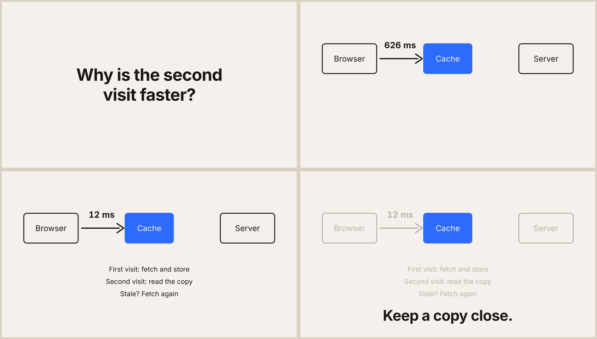
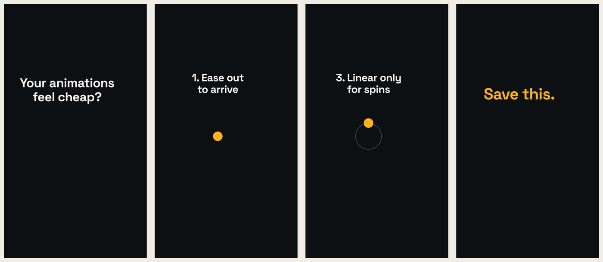

<p align="center">
  
</p>

<h1 align="center">brief2mp4</h1>

<p align="center"><b>Text to motion graphics for Claude Code and Codex. Write a video brief, get a finished MP4 that has been checked against every line of it.</b><br>2D explainers · maths animations · tutorials · Shorts and Reels · data stories · product launches · logo stings · kinetic type · 3D products</p>

<p align="center">
  <a href="https://github.com/qualixar/brief2mp4/releases"></a>
  <a href="https://github.com/qualixar/brief2mp4/actions/workflows/test.yml"></a>
  <a href="LICENSE"></a>
  
  
  
</p>

<p align="center">
  <a href="#quick-start">Quick start</a> ·
  <a href="#what-it-makes">What it makes</a> ·
  <a href="#how-it-works">How it works</a> ·
  <a href="#the-3d-pack">3D pack</a> ·
  <a href="#the-edit-pack">Edit pack</a> ·
  <a href="#examples">Examples</a> ·
  <a href="#write-a-brief">Write a brief</a> ·
  <a href="docs/README.md">Docs</a> ·
  <a href="#faq">FAQ</a>
</p>

brief2mp4 is a free, MIT-licensed agent skill. You paste a written brief (length, size, exact words, what happens when). The agent writes a spec with a checkable "done when" list, routes each beat to the right tool (HyperFrames for type and 2D motion, Three.js for stylised 3D, an optional 3D pack for CAD models, materials and physics, Blender for photoreal shots), renders, finishes the file with ffmpeg, measures it, looks at real frames, fixes what misses and hands you `final.mp4` with a `REPORT.md` that shows the evidence for every line. Everything runs on your own machine.

<p align="center">
  <a href="https://youtu.be/l9mEZQon6JM"></a>
</p>

<p align="center">
  <b><a href="https://youtu.be/l9mEZQon6JM">▶ Watch the video</a></b> &nbsp;·&nbsp; <b><a href="https://drive.google.com/drive/folders/1yBmCb2h63Fp5yr_37LY46f8BSRa_3GiO?usp=sharing">All 11 contest films, untouched</a></b> &nbsp;·&nbsp; <b><a href="https://qualixar.com/learn/guides/brief2mp4-guide">Free 13-page guide</a></b>
</p>

## Quick start

**Fastest: let your agent set everything up.** Open Claude Code or Codex in any folder and send:

> Set up brief2mp4 from https://github.com/qualixar/brief2mp4 by following its SETUP.md.

The agent detects your OS, asks before installing Node, ffmpeg (and Git Bash on Windows), installs the skill, runs the doctor and makes a 12-second test video so you know it works. [SETUP.md](SETUP.md) is the exact script it follows.

**Or install it yourself:**

| You use | Run |
|---|---|
| Claude Code (plugin) | `/plugin marketplace add qualixar/brief2mp4` then `/plugin install brief2mp4@brief2mp4` |
| Codex (plugin) | `codex plugin marketplace add qualixar/brief2mp4` then `codex plugin add brief2mp4@brief2mp4` |
| macOS / Linux / WSL (both apps) | `git clone https://github.com/qualixar/brief2mp4.git && bash brief2mp4/install.sh` |
| Windows PowerShell (both apps) | `git clone https://github.com/qualixar/brief2mp4.git; powershell -ExecutionPolicy Bypass -File .\brief2mp4\install.ps1 -InstallTools` |

Add the 3D pack with `--with-3d` (macOS/Linux) or `-With3D core` (Windows), and the edit pack with `--with-edit` or `-WithEdit film,sound`. Plugins install the skill only, so on a fresh machine also install the tools below. Start a new session after installing so the app loads the skill.

**Then make a video.** In a folder for the video:

> Use the brief2mp4 skill to make the video in this brief: *(paste your brief)*

When it says it is done, send one follow-up:

> Check it against the brief.

That makes the agent go back to your original brief line by line, show the evidence for each line, fix what falls short and render again. In our run of example 01 it caught headlines that cleared the 120 px minimum by only a few pixels, enlarged them and rendered again.

### Requirements

| Tool | Needed for | macOS | Windows | Ubuntu / Debian |
|---|---|---|---|---|
| Node.js 22+ | every video | `brew install node` | `winget install -e --id OpenJS.NodeJS.LTS` | [nodesource setup_22.x](https://github.com/nodesource/distributions) |
| ffmpeg | every video | `brew install ffmpeg` | `winget install -e --id Gyan.FFmpeg` | `sudo apt install ffmpeg` |
| Git Bash | Windows only (the scripts are bash) | | `winget install -e --id Git.Git` | |
| Blender 4.2+ | photoreal shots (optional) | `brew install --cask blender` | `winget install -e --id BlenderFoundation.Blender` | [blender.org/download](https://www.blender.org/download) |
| Python 3.12 or 3.13 | the 3D pack (optional) | `brew install python@3.12` | `winget install -e --id Python.Python.3.12` | Ubuntu 24.04: `sudo apt install python3 python3-venv` (Debian 12 ships 3.11: `uv python install 3.12`, then install with `B2M3D_PYTHON="$(uv python find 3.12)"`, see [uv](https://docs.astral.sh/uv/)) |

Check a machine at any time with `bash plugin/skills/brief2mp4/scripts/doctor.sh`. It prints `ok` or the exact install command for each tool.

## What it makes

<p align="center">
  
</p>

Round 4 of the video: Fable 5.2 in Claude Code got a written brief for a 60-second film, one continuous camera move through four worlds with its own music, and delivered this. That was a sealed contest run made without this skill; brief2mp4 packages the same loop (spec, build, measure, check every line, fix) so you can run it on your own briefs. The [full films](https://drive.google.com/drive/folders/1yBmCb2h63Fp5yr_37LY46f8BSRa_3GiO?usp=sharing) are untouched, with checksums.

| Format | What the skill does for it | Route |
|---|---|---|
| **2D explainers** (YouTube, courses) | hook, setup, three-step idea, example, takeaway; diagrams that draw on, labels word by word | HyperFrames |
| **Maths and algorithms** | equations term by term, colour-coded to the picture; one transformation per beat | HyperFrames + KaTeX, or [Manim](https://github.com/ManimCommunity/manim) inserts |
| **Tutorial intros and callouts** | title and chapter cards, callouts and zooms over your screen recording | HyperFrames + your recording |
| **Stories and skits** | situation, want, obstacle, turn; timing pauses before the punchline; captions to the voice | HyperFrames, SVG, Lottie or Rive characters |
| **YouTube Shorts, Reels, TikTok** | 9:16 safe zones, a hook in the first frame, a change every 2-4 s, loopable endings | HyperFrames |
| **Data stories** | charts that draw from the baseline, numbers that count to the exact value | HyperFrames + SVG/D3 |
| **Product launches** | problem, reveal, features, call to action; real UI recreated sharp | HyperFrames, 3D pack, Blender |
| **Logo stings and titles** | build-up, resolve on the sound accent, hold | HyperFrames, 3D pack |
| **Kinetic type and lyric videos** | words timed to measured audio, stress shown with scale and weight | HyperFrames |
| **Stylised 3D** | planets, particles, abstract shapes, flying cameras | Three.js |
| **3D products with physics** | parts that drop and settle, exploded views, turntables | 3D pack |
| **Photoreal shots** | glass, metal, soft shadows | Blender |

<p align="center">
  
  
</p>

Examples 05 (a 20 s explainer) and 06 (a 15 s vertical Short), each made by running the skill on the brief as written: both passed `check_delivery.sh`, and their [sample](examples/05-2d-explainer/SAMPLE-REPORT.md) [reports](examples/06-vertical-short/SAMPLE-REPORT.md) list the evidence for every line, including the fixes the self-check forced.

Every format has a beat sheet, a route and its own checks in [references/formats.md](plugin/skills/brief2mp4/references/formats.md), which the agent reads when your brief names the kind of video.

**Proof the skill works:** example brief 01, pasted as written, came back as a 12.000 s, 1920x1080, 30 fps file that passed the delivery check. Its [report](examples/01-kinetic-type/SAMPLE-REPORT.md) lists every requirement with its evidence: which still shows which line, the measured headline height (126 px against a 120 px minimum), the text bounds and the loudness at each sound accent.

## How it works

<p align="center">
  
</p>


1. **Spec.** Before any code the agent writes `SPEC.md`: size, frame rate, exact duration, codecs and loudness; every on-screen word copied exactly; the palette; a beat sheet with times; and a "done when" list with one checkable line per requirement.
2. **Route and build.** Each beat goes to the tool that fits it, starting from templates that already render. HyperFrames is the spine where every layer meets on one timeline.
3. **Self-check.** `check_delivery.sh` measures the file (PASS, WARN or FAIL). `contact_sheet.sh` pulls stills at the important moments, and the agent views them and marks every "done when" line met or not met, with evidence.
4. **Fix.** Worst miss first, render again, up to three rounds.
5. **Deliver.** `final.mp4` and a `REPORT.md` that says what was checked, how, and what is still open.

| The beat needs | Tool | Licence |
|---|---|---|
| Type, layouts, UI, charts, 2D motion | [HyperFrames](https://github.com/heygen-com/hyperframes) (HTML, CSS and [GSAP](https://github.com/greensock/GSAP) to MP4) | Apache-2.0 |
| Stylised 3D, particles, camera moves | [Three.js](https://github.com/mrdoob/three.js) inside HyperFrames, seeked by time | MIT |
| CAD models, materials, physics, exploded views | the optional [3D pack](#the-3d-pack) | MIT and Apache-2.0 parts |
| Realistic products, materials, soft light | [Blender](https://www.blender.org), scripted in Python, headless | GPL (external tool) |
| Sound, joins, exact length, loudness, encoding | [ffmpeg](https://ffmpeg.org) | LGPL/GPL (external tool) |

Mixed briefs, recipes for each mix and the architecture in detail: [docs/architecture.md](docs/architecture.md) for people, [references/pipelines.md](plugin/skills/brief2mp4/references/pipelines.md) for the agent.

## The 3D pack

<p align="center">
  
</p>

Example 04, rendered by the 3D pack on a laptop: five parts drop and settle with baked rigid-body physics, open into an exploded view, and the title lands. 8 seconds of 1080p rendered in about 5 seconds; `check_delivery.sh` passes.

An optional layer for briefs with 3D products. It turns a CAD or mesh spec into a GLB, applies material presets, bakes rigid-body physics once so every render frame is identical, writes a self-contained HyperFrames project from a short shot JSON, and renders photoreal hero shots through Blender. The skill detects it; without it, 3D beats use the Three.js template.

| Component | What it adds | Built on |
|---|---|---|
| `core` | models from mesh specs, material presets, physics bakes, GLB optimisation, shot JSON to HyperFrames | [three.js](https://github.com/mrdoob/three.js), [glTF-Transform](https://github.com/donmccurdy/glTF-Transform), [meshoptimizer](https://github.com/zeux/meshoptimizer), [Jolt Physics](https://github.com/jrouwe/JoltPhysics), [Manifold](https://github.com/elalish/manifold), [trimesh](https://github.com/mikedh/trimesh) |
| `cad` | exact parametric parts: enclosures, gears, brackets | [CadQuery](https://github.com/CadQuery/cadquery) |
| `blender` | photoreal hero renders on the GPU (Metal, OptiX, CUDA or CPU) | your installed [Blender](https://www.blender.org) |

```bash
bash install.sh --with-3d              # core
bash install.sh --with-3d=core,cad     # core + CadQuery
```

```powershell
powershell -ExecutionPolicy Bypass -File .\install.ps1 -With3D core,cad
```

The brief does the asking. "Parts fall and settle" becomes a physics bake with a camera that frames the landing zone; "show what's inside" becomes an exploded view; "hero product" becomes a Blender render with a dramatic light rig. The full mapping, the shot JSON and the look rules are in [3d/README-3D.md](plugin/skills/brief2mp4/3d/README-3D.md).

## The edit pack

Motion graphics are half of a video. The other half is editing: cutting your screen recording or footage on a timeline, mixing a voiceover over music so the music ducks when you speak, compositing titles, making the thumbnail. The optional edit pack installs the command-line tools of five free, open-source desktop editors, the ArtCraft apps by [storytold](https://github.com/storytold) (MIT or Apache-2.0, at your option), so Claude Code or Codex can do that work too, headless, and hand the result to the same checks.

<p align="center">
  
</p>

| Component | App | Like | The agent uses it for | Tested recipe |
|---|---|---|---|---|
| `film` | [FilmCraft](https://github.com/storytold/filmcraft) 0.20.1 | Premiere | cutting clips on a timeline, transitions, titles, export | `film_timeline.sh` |
| `sound` | [SoundCraft](https://github.com/storytold/soundcraft) 0.20.1 | a DAW | voice + music mix, ducking with automation, bounce | `sound_mix.sh` |
| `effect` | [EffectCraft](https://github.com/storytold/effectcraft) 0.24.1 | After Effects | layered, keyframed compositing and titles | `effect_title.sh` |
| `photo` | [PhotoCraft](https://github.com/storytold/photocraft) 0.23.1 | Photoshop | thumbnails, title cards | `photo_thumbnail.sh` |
| `vector` | [VectorCraft](https://github.com/storytold/vectorcraft) 0.24.1 | Illustrator | logos and lower thirds as SVG | `vector_lower_third.sh` |

```bash
bash install.sh --with-edit                                  # film + sound
bash install.sh --with-edit=film,sound,effect,photo,vector   # all five, about 420 MB download on macOS
```

```powershell
powershell -ExecutionPolicy Bypass -File .\install.ps1 -WithEdit film,sound
```

Every download is checked before anything is unpacked: its SHA-256 must match both the release's `SHA256SUMS.txt` and the hash pinned in this repository, and when `gpg` is installed the release signature must verify against the pinned signing-key fingerprint. Versions are pinned because these apps are alpha and move fast; the skill tells the agent to look up each app's real commands (`<app>-cli commands`) before using one a recipe does not cover. Details, sizes per platform and uninstall: [edit/README-EDIT.md](plugin/skills/brief2mp4/edit/README-EDIT.md).

## Examples

| # | Brief | Route | Length |
|---|---|---|---|
| 01 | [Kinetic type](examples/01-kinetic-type/BRIEF.md): "Finish something today" ([sample report](examples/01-kinetic-type/SAMPLE-REPORT.md)) | HyperFrames | 12 s |
| 02 | [Three.js](examples/02-threejs-orbit/BRIEF.md): a low-poly planet, three moons, "ORBIT" | Three.js in HyperFrames | 10 s |
| 03 | [Blender](examples/03-blender-product/BRIEF.md): a smart-speaker turntable, "LISTEN." | Blender | 8 s |
| 04 | [3D product](examples/04-3d-product/BRIEF.md): parts drop and settle, explode, title | 3D pack | 8 s |
| 05 | [2D explainer](examples/05-2d-explainer/BRIEF.md): "How a cache works" | HyperFrames | 20 s |
| 06 | [Vertical Short](examples/06-vertical-short/BRIEF.md): "3 easing rules", 1080x1920 with safe zones | HyperFrames | 15 s |
| 07 | [Edited tutorial](examples/07-edit-tutorial/BRIEF.md): two clips cut together with a title and a ducked voice-over mix | edit pack + HyperFrames | 14 s |

## Write a brief

The agent guesses less when the brief says more. A brief that works well has these parts:

```markdown
Length and size: 15 s, 1920x1080, 30 fps.
Look: background #F2EDE4, text #16130F, one accent #FF5A1F. Font: Space Grotesk Bold.
Words on screen, exactly: "First line." / "Second line." / "Last line."
What happens when:
- 0.0 to 4.0 s: the first line types on, one word at a time.
- 4.0 s: a hard cut to the second line.
- 9.0 s: the last line lands and holds still until the end.
Sound: a quiet bed with a low hit at 4.0 s.
Done when: every line is readable, nothing touches the frame edge, headlines are at least 100 px tall.
```

The "done when" lines matter most, because they are what the self-check measures. The [free guide](https://qualixar.com/learn/guides/brief2mp4-guide) goes through brief writing, each tool and the checks in detail.

## How it compares

brief2mp4 sits on top of the tools below rather than replacing them. The table compares scope as each project describes itself.

| | brief2mp4 | [HyperFrames skills](https://github.com/heygen-com/hyperframes) | [Remotion skills](https://github.com/remotion-dev/skills) | Prompting an agent with no skill |
|---|---|---|---|---|
| Input | a written brief | a request | a request in a Remotion project | a request |
| Writes a spec with a checkable done-when list | yes | | | |
| Routes beats across HyperFrames, Three.js, a 3D pack and Blender | yes | HyperFrames | Remotion | whatever the agent picks |
| Measures the delivered file (duration, size, codecs, loudness) | yes, PASS/WARN/FAIL | | | |
| Looks at frames and reports evidence per brief line | yes, `REPORT.md` | lint and preview | | |
| Physics and CAD 3D | optional 3D pack | | | |
| Licence | MIT | Apache-2.0 | see repo; Remotion has its own licence | |

They work well together: install the HyperFrames skills next to brief2mp4 for deeper HyperFrames know-how, and the agent uses both. For more than 45 other open-source motion, 3D, capture and agent-skill projects, with licences and how to bring each one into a brief2mp4 pipeline, see [references/ecosystem.md](plugin/skills/brief2mp4/references/ecosystem.md).

## FAQ

**Does it cost anything?** The skill is free and MIT licensed. The agent runs on your own Claude Code or Codex plan, and rendering happens on your machine.

**Which models has it been tested with?** Claude Code on Sonnet made briefs 01, 05 and 06 from the brief as written, each passing the delivery check (05 and 06 rendered in about 7 seconds each on an Apple M-series laptop). Stronger models handle harder briefs better, but the loop and the checks are the same for all of them.

**Does it work on Windows?** Yes, with Git for Windows installed (`install.ps1 -InstallTools` does it), because the scripts are bash. CI runs the install, the doctor and the tests on Windows, macOS and Ubuntu on every change. Full renders are tested on macOS.

**Does it upload my files anywhere?** No. Rendering, checks and reports stay in your project folder. The only network traffic is what the tools fetch: npm and PyPI packages at install time and any web fonts your brief names.

**What about music?** `sound_bed.sh` makes a quiet original placeholder so the file is never silent. For a real soundtrack, pass your own licensed track to `finish.sh --audio`.

**Can I use the scripts without an agent?** Yes. They are plain bash and ffmpeg, for example `bash plugin/skills/brief2mp4/scripts/check_delivery.sh my-video.mp4 --seconds 30`.

**How do I update or remove it?** Claude Code plugin: `claude plugin update brief2mp4@brief2mp4` or `claude plugin uninstall brief2mp4@brief2mp4`. Codex plugin: `codex plugin marketplace upgrade` or `codex plugin remove brief2mp4@brief2mp4`. Script install: `git pull` and run the installer again, or `install.sh --uninstall` / `install.ps1 -Uninstall`. The installers only replace or remove a folder they created; an existing `brief2mp4` folder is moved aside with a timestamp, never deleted.

## What is inside

```
SETUP.md                           the setup script an agent follows (macOS, Windows, Linux)
AGENTS.md, CLAUDE.md               what an agent opened in this repo should do
install.sh, install.ps1            install, update or remove for both apps; --with-3d / -With3D
.claude-plugin/marketplace.json    marketplace entry, read by Claude Code and Codex
plugin/
  .claude-plugin/plugin.json       Claude Code plugin manifest
  .codex-plugin/plugin.json        Codex plugin manifest
  skills/brief2mp4/
    SKILL.md                       the loop the agent follows
    references/                    formats, pipelines, ecosystem, hyperframes, threejs, blender, ffmpeg
    scripts/                       finish, check_delivery, contact_sheet, sound_bed, doctor, detect_3d,
                                   detect_edit, bounds.py, vendor_libs
    templates/                     SPEC.md, a Three.js scene, a Blender turntable
    3d/                            the optional 3D pack and its installers
    edit/                          the optional edit pack: verified installers, pinned versions, recipes
docs/                              getting started, architecture, 3D walkthrough
examples/                          seven briefs; 01, 05, 06 and 07 with sample reports, 04 with a worked build
tests/                             fast checks and render tests (bash tests/run_tests.sh [--slow])
```

## Contributing

Bad results are the most useful bug reports: open a **Brief result** issue with the brief, the app and model, and the `REPORT.md`. Code changes are welcome too; see [CONTRIBUTING.md](CONTRIBUTING.md). Security reports go through [SECURITY.md](SECURITY.md). Releases are listed in [CHANGELOG.md](CHANGELOG.md).

## Licence

MIT. Use it, change it, ship videos with it. HyperFrames (Apache-2.0), Three.js (MIT), GSAP (standard no-charge licence), Jolt (MIT), glTF-Transform (MIT), meshoptimizer (MIT), Manifold (Apache-2.0), CadQuery (Apache-2.0), trimesh (MIT), Blender (GPL), ffmpeg (LGPL/GPL) and the ArtCraft apps by storytold (MIT or Apache-2.0, downloaded from their own releases by the edit pack) keep their own licences; this repo does not bundle them.

Made by [Varun Pratap Bhardwaj](https://github.com/qualixar).
