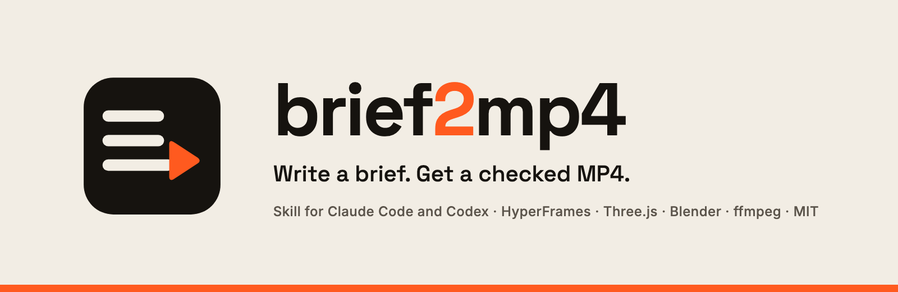
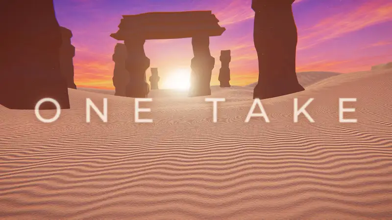
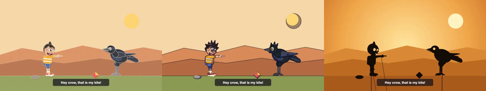
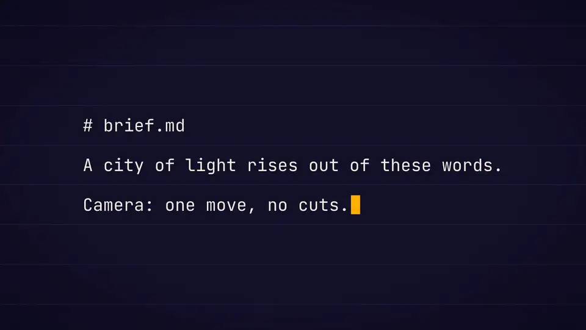
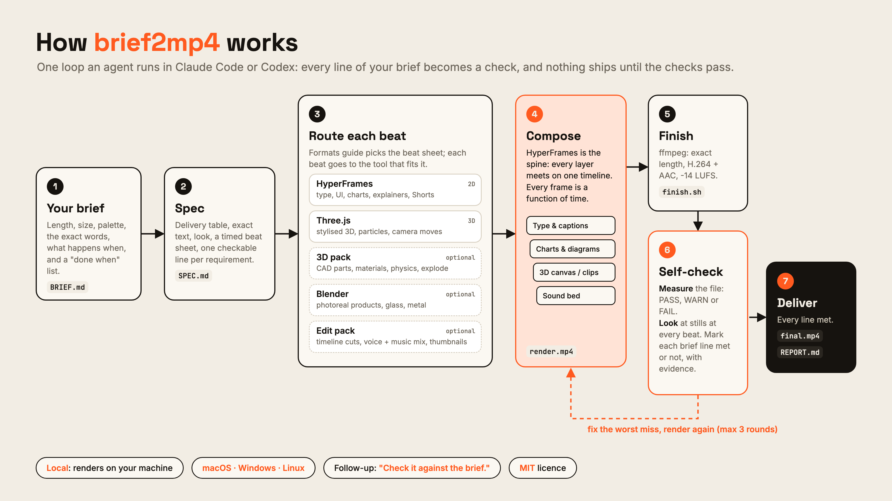
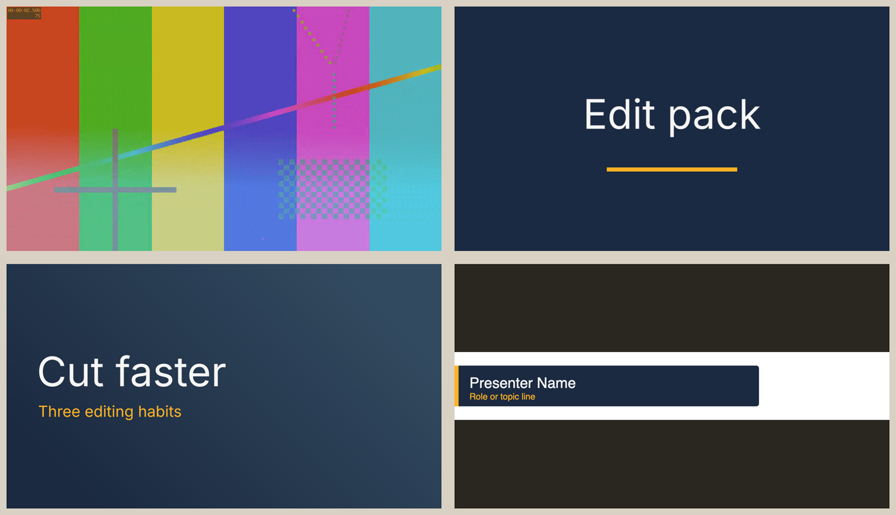

<p align="center">
  
</p>

<h1 align="center">brief2mp4</h1>

<p align="center"><b>Text to video for Claude Code and Codex. Write a brief, get a finished MP4 of motion graphics, an explainer video, a documentary, a YouTube Short or a 3D animation, checked against every line of your brief before you see it.</b><br>2D explainers · narrated documentaries · maths animations · tutorials · Shorts and Reels · data stories · product launches · logo stings · kinetic type · talking characters · Blender animation · 3D products with physics · 82 art forms from oil painting and Madhubani to manga, synthwave and silent film</p>

<p align="center">
  <a href="https://github.com/qualixar/brief2mp4/stargazers"></a>
  <a href="https://github.com/qualixar/brief2mp4/releases"></a>
  <a href="https://github.com/qualixar/brief2mp4/actions/workflows/test.yml"></a>
  <a href="LICENSE"></a>
  
  
  
</p>

<p align="center">
  <a href="#made-with-brief2mp4">Made with it</a> ·
  <a href="#quick-start">Quick start</a> ·
  <a href="#what-it-makes">What it makes</a> ·
  <a href="#how-it-works">How it works</a> ·
  <a href="#film-mode-narrated-explainers-and-documentaries">Film mode</a> ·
  <a href="#characters-that-walk-and-talk">Characters</a> ·
  <a href="#the-3d-pack-and-blender-motion-recipes">3D and Blender</a> ·
  <a href="#the-edit-pack">Edit pack</a> ·
  <a href="#art-forms-ask-for-a-look-by-name">Art forms</a> ·
  <a href="#examples">Examples</a> ·
  <a href="#faq">FAQ</a> ·
  <a href="docs/README.md">Docs</a>
</p>

https://github.com/user-attachments/assets/40f4f310-5ce1-46b9-a899-ded3ba520e79

<p align="center"><b>One kite story, 24 art forms.</b> Paper cut-out, Madhubani, anime, oil paint, synthwave, silent film and more, each scene made with brief2mp4 from <a href="#art-forms-ask-for-a-look-by-name">its 82 art forms</a>. Sound on.</p>

<p align="center">
  <a href="https://youtu.be/l9mEZQon6JM">▶ Fable 5.2 vs Opus 5.5 vs GPT-6.1, the contest video</a> · <a href="https://drive.google.com/drive/folders/1yBmCb2h63Fp5yr_37LY46f8BSRa_3GiO?usp=sharing">All 11 contest films, untouched</a> · <a href="https://qualixar.com/learn/guides/brief2mp4-guide">Free 104-page guide</a> · <a href="https://qualixar.com/research/blog/brief2mp4-deep-dive">How it was built</a>
</p>

## Made with brief2mp4

<table>
  <tr>
    <td width="50%" valign="top">
      
      <b>Blender motion recipes, 24 s.</b> Cloth, a hinged chain, folding paper, a walk with planted feet and a seamless loop, in one studio, cut to music. Every frame comes from the recipes.<br>
      <a href="examples/10-3d-motion/">How it was made</a>
    </td>
    <td width="50%" valign="top">
      
      <b>Four worlds, one camera move, 60 s.</b> Round 4 of the contest: Fable 5.2 in Claude Code built this from a written brief in a sealed run without the skill. brief2mp4 packages that same loop.<br>
      <a href="https://youtu.be/l9mEZQon6JM">How it was made</a>
    </td>
  </tr>
  <tr>
    <td colspan="2" valign="top">
      
      <b>Talking characters, three looks, one scene file.</b> A boy and a crow argue over a kite: the same rig, poses and mouth track in paper cut-out, anime and shadow puppet. <a href="examples/09-story-characters/">How it was made</a>
    </td>
  </tr>
  <tr>
    <td width="50%" valign="top">
      
      <b>3D product with real physics, 8 s.</b> Five parts drop and settle, open into an exploded view, and the title lands. It rendered in about 5 seconds on a laptop.<br>
      <a href="docs/3d-walkthrough.md">How it was made</a>
    </td>
    <td width="50%" valign="top">
      
      <b>One brief, five worlds, 25 s.</b> Words become a 3D city, a 2D chart world and a galaxy of 27,000 particles in one camera move with no cuts.<br>
      <a href="examples/08-brief-becomes-world/">How it was made</a>
    </td>
  </tr>
</table>

| You give it | You get back |
|---|---|
| A written brief: length, size, the exact words on screen, what happens when, and a "done when" list. | `final.mp4`, plus a `REPORT.md` that goes through your brief line by line with the measurement or still that backs each one. Example 01's report shows a 126 px headline against a 120 px minimum. |

brief2mp4 is a free, MIT-licensed agent skill for AI video that you can trust line by line. The agent writes the video as code (HTML and GSAP, Three.js, Blender Python), renders it on your machine, finishes it with ffmpeg, then measures the file and looks at real frames before it tells you it is done. Every frame is a function of time, so the same project renders the same frames again.

<p align="center">⭐ <b>Free and MIT. If brief2mp4 makes a video you keep, <a href="https://github.com/qualixar/brief2mp4">star the repo</a></b>; it is how other Claude Code and Codex users find it. Made something? Post it in <a href="https://github.com/qualixar/brief2mp4/discussions/categories/show-and-tell">Show and tell</a>.</p>

<p align="center"><b>New in 0.8.0:</b> <a href="#film-mode-narrated-explainers-and-documentaries">film mode</a>, from one brief to a finished explainer or documentary; six tested <a href="#the-3d-pack-and-blender-motion-recipes">Blender motion recipes</a>; delivery checks that never pass what they did not measure. From 0.7.0: <a href="#art-forms-ask-for-a-look-by-name">82 art forms</a> and the six-app <a href="#the-edit-pack">edit pack</a>. All changes: <a href="CHANGELOG.md">CHANGELOG.md</a>.</p>

## Quick start

**Fastest: let your agent set everything up.** Open Claude Code or Codex in any folder and send:

> Set up brief2mp4 from https://github.com/qualixar/brief2mp4 by following its SETUP.md.

The agent detects your OS, asks before installing Node, ffmpeg (and Git Bash on Windows), installs the skill, runs the doctor and makes a 12-second test video so you know it works. [SETUP.md](SETUP.md) is the exact script it follows.

**Or install it yourself:**

| You use | Run |
|---|---|
| Claude Code (plugin) | `/plugin marketplace add qualixar/brief2mp4` then `/plugin install brief2mp4@brief2mp4` |
| Codex (plugin) | `codex plugin marketplace add qualixar/brief2mp4` then `codex plugin add brief2mp4@brief2mp4` |
| macOS / Linux / WSL (both apps) | `git clone https://github.com/qualixar/brief2mp4.git && bash brief2mp4/install.sh` |
| Windows PowerShell (both apps) | `git clone https://github.com/qualixar/brief2mp4.git; powershell -ExecutionPolicy Bypass -File .\brief2mp4\install.ps1 -InstallTools` |

Plugins install the skill only, so on a fresh machine also install the tools below. The optional packs install with flags (`--with-3d`, `--with-edit`; see [3D](#the-3d-pack-and-blender-motion-recipes) and [edit](#the-edit-pack)). Start a new session after installing so the app loads the skill.

**Then make a video.** In a folder for the video:

> Use the brief2mp4 skill to make the video in this brief: *(paste your brief)*

When it says it is done, send one follow-up:

> Check it against the brief.

That makes the agent go back to your original brief line by line, show the evidence for each line, fix what falls short and render again. In our run of example 01 it caught headlines that cleared the 120 px minimum by only a few pixels, enlarged them and rendered again. The [getting started guide](docs/getting-started.md) walks through a first video on each system.

### Requirements

| Tool | Needed for | macOS | Windows | Ubuntu / Debian |
|---|---|---|---|---|
| Node.js 22+ | every video | `brew install node` | `winget install -e --id OpenJS.NodeJS.LTS` | [nodesource setup_22.x](https://github.com/nodesource/distributions) |
| ffmpeg | every video | `brew install ffmpeg` | `winget install -e --id Gyan.FFmpeg` | `sudo apt install ffmpeg` |
| Git Bash | Windows only (the scripts are bash) | | `winget install -e --id Git.Git` | |
| Blender 4.2+ | photoreal shots and the motion recipes (optional) | `brew install --cask blender` | `winget install -e --id BlenderFoundation.Blender` | [blender.org/download](https://www.blender.org/download) |
| Python 3.12 or 3.13 | the 3D pack (optional) | `brew install python@3.12` | `winget install -e --id Python.Python.3.12` | Ubuntu 24.04: `sudo apt install python3 python3-venv` (Debian 12 ships 3.11: `uv python install 3.12`, then install with `B2M3D_PYTHON="$(uv python find 3.12)"`, see [uv](https://docs.astral.sh/uv/)) |

Check a machine at any time with `bash plugin/skills/brief2mp4/scripts/doctor.sh`. It prints `ok` or the exact install command for each tool.

## What it makes

Name the kind of video in your brief and the agent follows that format's beat sheet, route and checks.

| Format | What the skill does for it | Route | Read more |
|---|---|---|---|
| **2D explainer videos** (YouTube, courses) | hook, setup, three-step idea, example, takeaway; diagrams that draw on, labels word by word | HyperFrames | [format](plugin/skills/brief2mp4/references/formats.md#2d-explainer-youtube-course-product-page), [example 05](examples/05-2d-explainer/BRIEF.md) |
| **Narrated explainers and documentaries** (1-10 min) | story, a script with a source per line, licensed archive pictures and maps, your voice, picture re-timed to it, mix, captions, checks | film mode | [film mode guide](docs/film-mode.md) |
| **Maths and algorithms** | equations term by term, colour-coded to the picture; one transformation per beat | HyperFrames + KaTeX, or [Manim](https://github.com/ManimCommunity/manim) inserts | [format](plugin/skills/brief2mp4/references/formats.md#maths-and-algorithms) |
| **Tutorial intros and callouts** | title and chapter cards, callouts and zooms over your screen recording | HyperFrames + your recording | [format](plugin/skills/brief2mp4/references/formats.md#tutorial-and-screen-recording-intros) |
| **Edited tutorials, vlogs and skits from footage** | clips cut on a timeline, a voice-over mixed over ducked music, titles on top | edit pack | [edit pack guide](docs/edit-pack.md), [example 07](examples/07-edit-tutorial/BRIEF.md) |
| **Stories and skits with characters** | situation, want, obstacle, turn; characters that walk, blink and lip-sync to the voice | character kit | [character kit](plugin/skills/brief2mp4/characters/README-CHARACTERS.md), [example 09](examples/09-story-characters/) |
| **YouTube Shorts, Reels, TikTok** | 9:16 safe zones, a hook in the first frame, a change every 2-4 s, loopable endings | HyperFrames | [format](plugin/skills/brief2mp4/references/formats.md#vertical-shorts-and-reels-916), [example 06](examples/06-vertical-short/BRIEF.md) |
| **Data stories** | charts that draw from the baseline, numbers that count to the exact value | HyperFrames + SVG/D3 | [format](plugin/skills/brief2mp4/references/formats.md#data-stories-and-charts) |
| **Product launches** | problem, reveal, features, call to action; real UI recreated sharp | HyperFrames, 3D pack, Blender | [format](plugin/skills/brief2mp4/references/formats.md#product-launch-and-feature-announcements) |
| **Logo stings and titles** | build-up, resolve on the sound accent, hold | HyperFrames, 3D pack | [format](plugin/skills/brief2mp4/references/formats.md#logo-stings-and-titles) |
| **Kinetic type and lyric videos** | words timed to measured audio, stress shown with scale and weight | HyperFrames | [format](plugin/skills/brief2mp4/references/formats.md#kinetic-typography-and-lyric-videos), [example 01](examples/01-kinetic-type/BRIEF.md) |
| **Stylised 3D animation** | planets, particles, abstract shapes, flying cameras | Three.js | [Three.js notes](plugin/skills/brief2mp4/references/threejs.md), [example 02](examples/02-threejs-orbit/BRIEF.md) |
| **3D products with physics** | parts that drop and settle, exploded views, turntables | 3D pack | [3D walkthrough](docs/3d-walkthrough.md), [example 04](examples/04-3d-product/BRIEF.md) |
| **Blender animation** | seamless loops, cloth, hinged chains, folding, walks, retiming; photoreal glass, metal and soft shadows | Blender, headless | [motion recipes](docs/3d-walkthrough.md#7-blender-motion-recipes), [example 03](examples/03-blender-product/BRIEF.md), [example 10](examples/10-3d-motion/) |
| **Captions over any video** | word-timed captions from the measured audio | HyperFrames | [format](plugin/skills/brief2mp4/references/formats.md#captions-over-any-video) |

<p align="center">
  
  
</p>

Examples 05 (a 20 s explainer) and 06 (a 15 s vertical Short), each made by running the skill on the brief as written: both passed `check_delivery.sh`, and their [sample](examples/05-2d-explainer/SAMPLE-REPORT.md) [reports](examples/06-vertical-short/SAMPLE-REPORT.md) list the evidence for every line, including the fixes the self-check forced.

## How it works

<p align="center">
  
</p>

A render that finished is not a video that is right. brief2mp4 is the loop that closes that gap, in five steps the agent runs every time:

1. **Spec.** Before any code the agent writes `SPEC.md`: size, frame rate, exact duration, codecs and loudness; every on-screen word copied character for character; the palette; a beat sheet with times; and a "done when" list with one checkable line per requirement in your brief. That list is the contract the video is checked against.
2. **Route and build.** Each beat goes to the tool that fits it, starting from templates that already render. HyperFrames is the spine where every layer meets on one timeline, so type always sits sharp above any 3D.
3. **Self-check.** Scripts measure what a script can. `check_delivery.sh` checks duration to the frame, size, frame rate, codecs, loudness, true peak, black and frozen stretches, one-frame flicker and pops at joins. `check_clutter.py` checks the layout (no card on card, 24 px between text, at most four text blocks, nothing clipped). `ocr_sweep.sh` reads the finished frames for placeholder text and leaked file paths. Then the agent pulls stills at the important moments with `contact_sheet.sh`, looks at them, and marks every "done when" line met or not met, with the evidence. A check that could not measure never passes: a missing optional tool ends `RESULT: INCOMPLETE`, not PASS.
4. **Fix.** Worst miss first, render again, up to three rounds.
5. **Deliver.** `final.mp4` and a `REPORT.md` that says what was checked, how, and what is still open.

| The beat needs | Tool |
|---|---|
| Type, layouts, UI, charts, 2D motion | [HyperFrames](https://github.com/heygen-com/hyperframes) (HTML, CSS and [GSAP](https://github.com/greensock/GSAP) to MP4) |
| Stylised 3D, particles, camera moves | [Three.js](https://github.com/mrdoob/three.js) inside HyperFrames, seeked by time |
| CAD models, materials, physics, exploded views | the optional [3D pack](#the-3d-pack-and-blender-motion-recipes) |
| Realistic products, materials, soft light; cloth, chains, walks, loops | [Blender](https://www.blender.org), scripted in Python, headless |
| Footage cut on a timeline, multitrack mixing, compositing | the optional [edit pack](#the-edit-pack) |
| Sound, joins, exact length, loudness, encoding | [ffmpeg](https://ffmpeg.org) |

The loop, the routing and why every frame is a function of time: [docs/architecture.md](docs/architecture.md) for people, [references/pipelines.md](plugin/skills/brief2mp4/references/pipelines.md) for the agent.

## Film mode: narrated explainers and documentaries

One brief in a project folder; a finished narrated explainer or short documentary out, one to ten minutes long. Film mode writes every stage to a file you can open: the story, a script where every factual line carries its source URL, the storyboard, the pictures with their licences, your measured voice, the mix, the captions and the report. The render refuses any line without a source, so nothing unsourced reaches the screen by accident.

Why you would want it: archive pictures come only as public domain, CC0 or CC BY, with the credit written for you; maps of any country or region are drawn offline from Natural Earth; sound effects are made in code, so there is nothing to license; and your voice is never time-stretched, because the picture is re-timed to it.

```bash
python3 plugin/skills/brief2mp4/scripts/film.py run --project my-film     # every stage, from BRIEF.md to REPORT.md
```

Read next: the [film mode guide](docs/film-mode.md), with a run you can try in a minute.

## Characters that walk and talk

A brief that says "two characters talk, walk or argue" gets characters that hold poses, walk to a mark with their feet planted, blink, and move their mouths in time with the voice. One rig, 15 named poses, six skins (paper cut-out, cel-shaded anime, line art, shadow puppet, motion comic, flat explainer), and lip sync from word timings in English and Devanagari Hindi. Bring your own art as PNG or WebP parts. The kit is plain JavaScript and JSON with no new dependency.

Why you would want it: a story or skit in any of those looks without a separate animation tool, and the same scene file renders in every skin by changing one flag.

```bash
python3 plugin/skills/brief2mp4/scripts/character_project.py --scene scene.json --skin cel-shaded --out project/
```

Read next: the [character kit](plugin/skills/brief2mp4/characters/README-CHARACTERS.md) and [example 09](examples/09-story-characters/).

## The 3D pack and Blender motion recipes

An optional layer for 3D product shots and Blender animation. It turns a CAD or mesh spec into a GLB, applies material presets, bakes rigid-body physics once so every render frame is identical, writes a HyperFrames project from a short shot JSON, and renders photoreal hero shots through Blender. It also ships six tested Blender motion recipes: a seamless loop, retiming between markers, a cloth drop, a hinged chain, folding paper and a walk with planted feet. Each recipe prints the numbers that prove it worked, such as how far a planted foot slid.

Why you would want it: "parts fall and settle", "show what's inside" and "a cloth drops over it" become real physics and real Blender animation instead of hand-keyed guesses. Without the pack, 3D beats use the Three.js template and the report says so.

```bash
bash install.sh --with-3d                     # Windows: install.ps1 -With3D core; add CadQuery with --with-3d=core,cad
~/.brief2mp4/3d/venv/bin/brief2mp4-3d recipe run cloth -- --object sphere --frames 90 --out frames
```

A running Blender can also be driven live through [blender-mcp](https://github.com/ahujasid/mcp-for-blender) (MIT) to decide a look by eye; renders stay headless so they repeat. Optional generators you install yourself make a prop from a picture or a prompt: [Hunyuan3D-2](https://github.com/Tencent-Hunyuan/Hunyuan3D-2) (its licence excludes the EU, UK and South Korea) and [TRELLIS](https://github.com/microsoft/TRELLIS) (its code is MIT, but its GLB export runs non-commercial components, so the wrapper needs `--non-commercial`).

Read next: the [3D walkthrough](docs/3d-walkthrough.md): example 04 step by step, the recipes, live Blender and every generator's licence.

## The edit pack

Motion graphics are half of a video. The other half is editing: cutting your screen recording or footage on a timeline, mixing a voice-over over music so the music ducks when you speak, compositing titles, making the thumbnail. The optional edit pack installs the command-line tools of six free, open-source desktop editors, the ArtCraft apps by [storytold](https://github.com/storytold): FilmCraft (timeline editing), SoundCraft (multitrack audio), EffectCraft (compositing), PhotoCraft (images), VectorCraft (SVG) and LightCraft (photo grading).

Why you would want it: Claude Code or Codex can then cut and mix real footage headless and hand the result to the same checks. Every download is verified against the release's checksums, a hash pinned in this repository and, when gpg is installed, the release signature.

<p align="center">
  
</p>

```bash
bash install.sh --with-edit                   # FilmCraft + SoundCraft; all six: --with-edit=film,sound,effect,photo,vector,light
```

Read next: the [edit pack guide](docs/edit-pack.md): the six apps and their pinned versions, download sizes, how verification works, and the tested recipes.

## Art forms: ask for a look by name

<p align="center">
  
</p>

Say "claymation", "paper cut-out", "anime", "like a blueprint" or "shadow puppets" and the skill has a recipe for it. Each of the 82 art forms has a page with what makes it read as that form, its timing, how to build it in HyperFrames, canvas, SVG or Three.js, the assets and sound it needs, what makes it look wrong, and its sources. The picture above is one frame from each of the 82 demos, drawn by the same browser check the tests run.

| Family | Art forms |
|---|---|
| Craft and handmade | claymation, stop-motion look, paper cut-out, felt and fabric craft, origami, shadow puppetry, collage and mixed media, risograph and halftone print, pop-up book, papercut and sanjhi, brick toy, string puppet and kathputli |
| Drawn and painted | anime and cel shading, 2D flat vector explainer, whiteboard and doodle, watercolour, ink wash, line art, rotoscope look, motion comic, UPA and mid-century modern, rubber-hose cartoon, linocut and woodcut print, pencil sketch, charcoal, oil painting and impasto, gouache storybook, crayon and oil pastel, chalkboard, one continuous line, paint-on-glass, sand animation, retro anime, manga, chibi, modern TV cartoon, gothic cartoon |
| Geometry, pixels and 3D | isometric, low-poly 3D, voxel, pixel art, 3D product render, stylised 3D cartoon, Toon 3D, point cloud and lidar scan, tilt-shift miniature diorama, parallax 2.5D |
| Type, data and retro | kinetic typography, infographic and data animation, lyric video, VHS and glitch, blueprint and technical drawing, neon sign, maths diagram, sticker explainer, Memphis design |
| Folk and print traditions | Madhubani, Warli, Pattachitra, Gond, Indian miniature, engraving and banknote hatching, silkscreen poster, art deco, stained glass, ukiyo-e woodblock |
| Screens and cinema | synthwave and outrun, cyberpunk night city, ASCII art, 1-bit dither, CRT terminal, hologram HUD, thermal camera, silent film, newsreel, film noir, archive documentary |
| Abstract and generative | particles, liquid metaball, flow-field generative, psychedelic, Bauhaus geometric |

Three rules carry all of them: the picture is a function of time; handmade looks hold their drawings at 8 to 12 changes a second while the video stays at 24 or 30; and every wobble, flicker and misregistration is seeded by the drawing number, so two renders of the same frame match. The demos are starting points for a scene, not finished films.

```bash
python3 plugin/skills/brief2mp4/scripts/art_route.py BRIEF.md     # proposes a form from your brief and says why
```

Read next: the [art forms index](plugin/skills/brief2mp4/references/art-forms.md) and the [art forms guide](docs/art-forms-guide/brief2mp4-art-forms.pdf) (PDF, 87 pages, one picture per form; its source is in [docs/art-forms-guide/](docs/art-forms-guide/README.md)).

## Examples

Every example is a brief you can paste as it is.

| # | Brief | Route | Length |
|---|---|---|---|
| 01 | [Kinetic type](examples/01-kinetic-type/BRIEF.md): "Finish something today" ([sample report](examples/01-kinetic-type/SAMPLE-REPORT.md)) | HyperFrames | 12 s |
| 02 | [Three.js](examples/02-threejs-orbit/BRIEF.md): a low-poly planet, three moons, "ORBIT" | Three.js in HyperFrames | 10 s |
| 03 | [Blender](examples/03-blender-product/BRIEF.md): a smart-speaker turntable, "LISTEN." | Blender | 8 s |
| 04 | [3D product](examples/04-3d-product/BRIEF.md): parts drop and settle, explode, title ([walkthrough](docs/3d-walkthrough.md)) | 3D pack | 8 s |
| 05 | [2D explainer](examples/05-2d-explainer/BRIEF.md): "How a cache works" ([sample report](examples/05-2d-explainer/SAMPLE-REPORT.md)) | HyperFrames | 20 s |
| 06 | [Vertical Short](examples/06-vertical-short/BRIEF.md): "3 easing rules", 1080x1920 with safe zones ([sample report](examples/06-vertical-short/SAMPLE-REPORT.md)) | HyperFrames | 15 s |
| 07 | [Edited tutorial](examples/07-edit-tutorial/BRIEF.md): two clips cut together with a title and a ducked voice-over mix ([sample report](examples/07-edit-tutorial/SAMPLE-REPORT.md)) | edit pack + HyperFrames | 14 s |
| 08 | [Five worlds](examples/08-brief-becomes-world/BRIEF.md): a brief's words become a 3D city, a 2D chart world and a galaxy in one camera move ([how to make and check it](examples/08-brief-becomes-world/README.md), [video](assets/example08-five-worlds.mp4)) | HyperFrames + Three.js | 25 s |
| 09 | [Talking characters](examples/09-story-characters/BRIEF.md): a boy and a crow argue over a kite, one scene in several skins ([how to make it](examples/09-story-characters/README.md)) | character kit | 14 s |
| 10 | [Five motions, one studio](examples/10-3d-motion/BRIEF.md): cloth, a chain, folding, a walk and a loop, cut to music ([how to make it](examples/10-3d-motion/README.md)) | Blender motion recipes | 24 s |

## Write a brief

The agent guesses less when the brief says more. A brief that works well has these parts:

```markdown
Length and size: 15 s, 1920x1080, 30 fps.
Look: background #F2EDE4, text #16130F, one accent #FF5A1F. Font: Space Grotesk Bold.
Words on screen, exactly: "First line." / "Second line." / "Last line."
What happens when:
- 0.0 to 4.0 s: the first line types on, one word at a time.
- 4.0 s: a hard cut to the second line.
- 9.0 s: the last line lands and holds still until the end.
Sound: a quiet bed with a low hit at 4.0 s.
Done when: every line is readable, nothing touches the frame edge, headlines are at least 100 px tall.
```

The "done when" lines matter most, because they are what the self-check measures. The [free 104-page field guide](https://qualixar.com/learn/guides/brief2mp4-guide) goes through brief writing, every format, each tool, the packs and the checks in detail, and includes every brief and setting from the contest in the video. The [technical deep dive](https://qualixar.com/research/blog/brief2mp4-deep-dive) explains the engineering: determinism, baked physics, the loudness loop and the self-check.

## How it compares

brief2mp4 sits on top of the tools below rather than replacing them. The table compares scope as each project describes itself.

| | brief2mp4 | [HyperFrames skills](https://github.com/heygen-com/hyperframes) | [Remotion skills](https://github.com/remotion-dev/skills) | Prompting an agent with no skill |
|---|---|---|---|---|
| Input | a written brief | a request | a request in a Remotion project | a request |
| Writes a spec with a checkable done-when list | yes | | | |
| Routes beats across HyperFrames, Three.js, a 3D pack and Blender | yes | HyperFrames | Remotion | whatever the agent picks |
| Measures the delivered file (duration, size, codecs, loudness) | yes, PASS/WARN/FAIL | | | |
| Looks at frames and reports evidence per brief line | yes, `REPORT.md` | lint and preview | | |
| Physics and CAD 3D | optional 3D pack | | | |
| Licence | MIT | Apache-2.0 | see repo; Remotion has its own licence | |

They work well together: install the HyperFrames skills next to brief2mp4 for deeper HyperFrames know-how, and the agent uses both. For more than 60 other open-source motion, 3D, capture and agent-skill projects, with licences and how to bring each one into a brief2mp4 pipeline, see [references/ecosystem.md](plugin/skills/brief2mp4/references/ecosystem.md).

## FAQ

**Is brief2mp4 an AI video generator?** Not in the sense of a model that paints pixels from a prompt. The agent (Claude Code or Codex) writes the video as code, in HTML and GSAP, Three.js or Blender Python, and renders it on your machine. Every frame is a function of time, so the same project renders the same video twice, the words on screen are exactly the words in your brief, and every claim in the report can be checked. Optional image-to-3D generators exist for props, and you install them yourself.

**Does it cost anything?** The skill is free and MIT licensed. The agent runs on your own Claude Code or Codex plan, and rendering happens on your machine.

**Which models has it been tested with?** Claude Code on Sonnet made briefs 01, 05 and 06 from the brief as written, each passing the delivery check (05 and 06 rendered in about 7 seconds each on an Apple M-series laptop). Stronger models handle harder briefs better, but the loop and the checks are the same for all of them.

**Can it make YouTube Shorts and Reels?** Yes. Ask for a vertical video and it renders 1080x1920 with conservative safe zones that keep text clear of the buttons and captions YouTube Shorts, Instagram Reels and TikTok draw on top, and it measures where the text sits. See [example 06](examples/06-vertical-short/BRIEF.md).

**Can it make a narrated explainer or documentary with my own voice?** Yes, with [film mode](docs/film-mode.md). Record the script lines with a pause between them; the take is cut into lines and the picture is re-timed to your voice, never the other way round. Each factual line needs a source, and archive pictures come only with licences you can publish.

**Can I use the videos commercially?** The skill is MIT and the videos you make are yours. A few optional parts have their own terms: CC BY pictures and music need the credit that film mode writes into its report for you; the optional F5-TTS voice and MusicGen music models are licensed for non-commercial use only; TRELLIS's GLB export runs non-commercial, research-only components; and Hunyuan3D-2's licence does not cover the EU, UK or South Korea. The generators write a credit and licence file next to each mesh. This is a summary, not legal advice; each guide quotes the licence.

**Does it need a GPU?** No. 2D and Three.js videos render in headless Chrome on an ordinary laptop. Blender uses the GPU when there is one (Metal, OptiX or CUDA) and the CPU otherwise. Only the optional image-to-3D generators want a large GPU; TRELLIS documents an NVIDIA GPU with at least 16 GB.

**Does it work on Windows?** Yes, with Git for Windows installed (`install.ps1 -InstallTools` does it), because the scripts are bash. CI runs the install, the doctor and the tests on Windows, macOS and Ubuntu on every change. Full renders are tested on macOS.

**Does it upload my files anywhere?** No. Rendering, checks and reports stay in your project folder. The only network traffic is what the tools fetch: npm and PyPI packages at install time, any web fonts your brief names, and, when you ask for them, archive pictures and music.

**What about music?** `sound_bed.sh` makes a quiet original placeholder so the file is never silent. For a real soundtrack, pass your own licensed track to `finish.sh --audio`, or let `fetch_music.py` find a CC0 or CC BY track and write its attribution.

**Can I use the scripts without an agent?** Yes. They are plain bash, Python and ffmpeg, for example `bash plugin/skills/brief2mp4/scripts/check_delivery.sh my-video.mp4 --seconds 30` to check any MP4.

**How do I update or remove it?** Claude Code plugin: `claude plugin update brief2mp4@brief2mp4` or `claude plugin uninstall brief2mp4@brief2mp4`. Codex plugin: `codex plugin marketplace upgrade` or `codex plugin remove brief2mp4@brief2mp4`. Script install: `git pull` and run the installer again, or `install.sh --uninstall` / `install.ps1 -Uninstall`. The installers only replace or remove a folder they created; an existing `brief2mp4` folder is moved aside with a timestamp, never deleted.

## brief2motion: websites that move, installed with brief2mp4

brief2mp4 makes the video. Its sister skill [brief2motion](https://github.com/qualixar/brief2motion) makes the website: write a plain brief and get a site with professional motion, checked in a real browser before you see it. It routes the brief to the right stack (GSAP scroll stories, three.js 3D product pages, Motion kinetic type, View Transitions, SVG and D3 data stories, Lottie, particles that form your product or face) and to one of 32 visual styles, from neubrutalism and glassmorphism to Swiss and Y2K.

https://github.com/user-attachments/assets/8b780cc9-e70f-4c7c-b3ac-7fdb56ede3ff

**You already have it.** brief2mp4 lists brief2motion as a plugin dependency, so installing brief2mp4 in Claude Code installs both. On a brief2mp4 older than 0.4.0, run `claude plugin update brief2mp4@brief2mp4` in a terminal, then `/reload-plugins` in Claude Code. In Codex, add it on its own: `codex plugin marketplace add qualixar/brief2motion`, then `codex plugin add brief2motion@brief2motion`.

Then ask in your own words: *"Build a launch page for our table radio: a 3D model that turns as I scroll, opens to show the parts, then lets me pick a colour."* Example sites, the stack references and a [free 53-page guide](https://qualixar.com/learn/guides/brief2motion-guide) are in the [brief2motion repo](https://github.com/qualixar/brief2motion). The two skills hand work to each other: brief2motion can film its page and pass it to brief2mp4 to finish as an MP4.

## Contributing

Made something with it? Post the brief and the video in [Show and tell](https://github.com/qualixar/brief2mp4/discussions/categories/show-and-tell); the best ones go into the examples table with your name on them. Bad results are the most useful bug reports: open a **Brief result** issue with the brief, the app and model, and the `REPORT.md`. Code changes are welcome too; see [CONTRIBUTING.md](CONTRIBUTING.md), and [docs/architecture.md](docs/architecture.md) for a map of the repository. Security reports go through [SECURITY.md](SECURITY.md). Releases are listed in [CHANGELOG.md](CHANGELOG.md).

## Licence

MIT. Use it, change it, ship videos with it. HyperFrames (Apache-2.0), Three.js (MIT), GSAP (standard no-charge licence), Jolt (MIT), glTF-Transform (MIT), meshoptimizer (MIT), Manifold (Apache-2.0), CadQuery (Apache-2.0), trimesh (MIT), Blender (GPL), ffmpeg (LGPL/GPL) and the ArtCraft apps by storytold (MIT or Apache-2.0, downloaded from their own releases by the edit pack) keep their own licences; this repo does not bundle them. Optional tools you install yourself, and the data film mode fetches, carry their own terms, listed in [references/ecosystem.md](plugin/skills/brief2mp4/references/ecosystem.md).

Made by [Varun Pratap Bhardwaj](https://github.com/qualixar). If it saved you a day of editing, a ⭐ is the thank-you that helps most.
