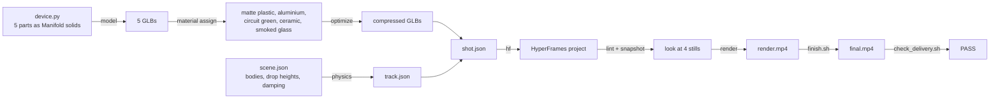

# 3D walkthrough: from a brief to a physics product shot

This guide follows example 04 from brief to checked MP4, so you can see what the agent does with the 3D pack and do the same by hand. The full command reference is [3d/README-3D.md](../plugin/skills/brief2mp4/3d/README-3D.md).

<p align="center">
  
</p>

## 1. Install the pack (once)

```bash
bash install.sh --with-3d                 # macOS, Linux: core (about 280 MB)
bash install.sh --with-3d=core,cad        # add CadQuery for exact CAD parts (about 1.3 GB more)
```

```powershell
powershell -ExecutionPolicy Bypass -File .\install.ps1 -With3D core
```

It installs into `~/.brief2mp4/3d` with its own Python venv and Node packages, so your global Python and npm stay untouched. `bash plugin/skills/brief2mp4/scripts/detect_3d.sh` prints `3d: ready` when it worked.

## 2. Read the brief as shots

[Brief 04](../examples/04-3d-product/BRIEF.md) asks for five parts of a small sensor to drop and settle, open into an exploded view, and close on a title. The agent translates each phrase:

| Brief phrase | Shot JSON |
|---|---|
| "the parts fall one after another ... and settle" | a `physics` bake; each model gets `track: "<part>"` |
| "real rigid-body physics, not hand-keyed" | Jolt, baked once to `track.json`, replayed by time |
| "the stack opens into an exploded view" | `explode` with an upward offset per part, eased in and out |
| "camera pushes in ... then pulls back to frame the whole column" | `camera.keys` (the automatic camera does not know about the explode) |
| "neutral tone mapping, a dim environment, strong key light, bloom off" | `tonemapping: "neutral"`, `envIntensity: 0.35`, `lights: "dramatic"`, no `bloom` |
| "title bottom left ... fades out before the end" | `titles` with `position: "bottom-left"`, `start` and `duration` |

## 3. The build, step by step



The worked files ship with the pack in `plugin/skills/brief2mp4/3d/examples/04-3d-product/`: `device.py` (the parts), `scene.json` (the physics), `shot.json` (camera, lights, explode, title) and `build.py`, which runs every step. With the pack's Python:

```bash
export B2M3D_HOME=~/.brief2mp4/3d
$B2M3D_HOME/venv/bin/python plugin/skills/brief2mp4/3d/examples/04-3d-product/build.py ~/videos/ex04
cd ~/videos/ex04/project
npx --yes hyperframes@0.8.216 lint
npx --yes hyperframes@0.8.216 snapshot --at 1.2,2.9,3.9,7.8
npx --yes hyperframes@0.8.216 render . -o ../render.mp4 --quality delivery --fps 30 --workers 4
```

Each `b2m3d` subcommand prints one JSON result (`build.py` hides them for brevity; run the steps by hand to see them), so an agent can read exactly what happened. Then finish and check:

```bash
cd ..                                   # back to ~/videos/ex04, where render.mp4 is
S=/path/to/brief2mp4/plugin/skills/brief2mp4/scripts   # your clone, or the installed skill folder
bash $S/sound_bed.sh bed.wav --seconds 8 --hits 0.6,1.2,1.8,2.4,3.0,3.2
bash $S/finish.sh --in render.mp4 --out final.mp4 --seconds 8 --audio bed.wav
bash $S/check_delivery.sh final.mp4 --seconds 8 --size 1920x1080 --fps 30
bash $S/contact_sheet.sh final.mp4 --at 1.2,2.9,3.9,6.2
```

On an Apple M-series laptop the 8 s render takes about 5 seconds and the delivery check passes.

## 4. Look before you render the full shot

Snapshots cost seconds; a wrong full render costs minutes. Check each still for:

- **Framing.** Is the subject in frame at every sampled time? A camera that frames the fall instead of the landing zone makes the parts tiny.
- **Contact.** Do shadows sit under the parts? A floating shadow means `ground.y` is off.
- **Colour.** Is the green board green and the white cover white? Colours in glTF are linear: convert sRGB with `(c / 255) ** 2.2` (`b2m3d material linear "#rrggbb"` does it).
- **Text.** Is the title spelled exactly, clear of the product, and inside the safe margins? In our first render of this example the end of "inside." touched the tray; dropping the title from 76 px to 64 px fixed it.

## 5. Make it your own

| You want | Change |
|---|---|
| A different product | Edit `device.py`: each part is a Manifold solid with a name, colour, metalness and roughness. With the `cad` component, return CadQuery parts for fillets and exact dimensions |
| A turntable instead of a drop | Remove `physics` and `track`; give the model `spin` (degrees per second) and a fixed camera |
| A photoreal hero frame | `b2m3d blender product.glb frames/ --mp4 hero.mp4 --look dramatic`, then place `hero.mp4` as a video layer under your title |
| A glowing logo | `material assign ... --assign '*=neon_emissive'` and `"bloom": true` (the only case where bloom helps) |
| Your palette | `background` (any CSS) and `accent` in the shot; pick material presets that sit well on it |

## Without the pack

If `detect_3d.sh` says `not installed`, the skill still makes 3D shots with the Three.js template (`templates/threejs/index.html`): stylised scenes, orbits, particles, hand-keyed motion. It says in `REPORT.md` that physics and exploded views were animated by hand, and how to add the pack (`3d/install_3d.sh --components core` from the skill folder).
