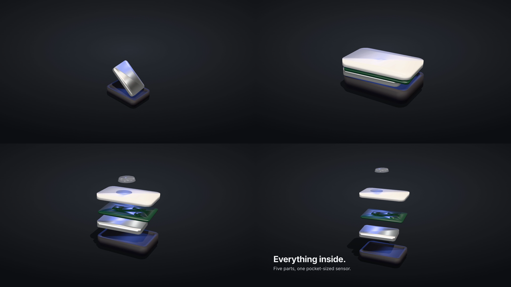
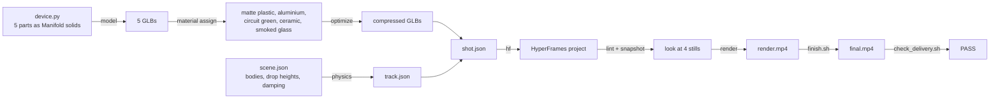
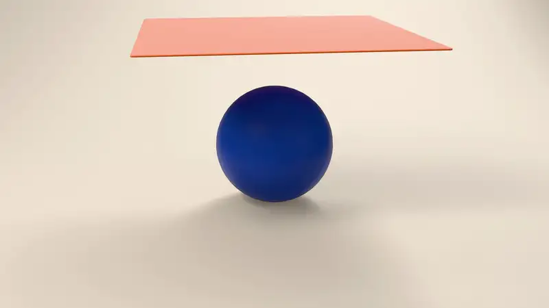

# 3D walkthrough: physics product shots, Blender animation recipes and live Blender

The first half of this guide follows example 04 from brief to checked MP4, so you can see what the agent does with the 3D pack and do the same by hand. The second half covers what the pack adds for Blender animation: [six tested motion recipes](#7-blender-motion-recipes), [driving a live Blender](#8-live-blender-decide-by-eye-render-headless) and the [optional 3D generators with their licences](#9-optional-generators-and-their-licences). The full command reference is [3d/README-3D.md](../plugin/skills/brief2mp4/3d/README-3D.md).

<p align="center">
  
</p>

## 1. Install the pack (once)

```bash
bash install.sh --with-3d                 # macOS, Linux: core (about 280 MB)
bash install.sh --with-3d=core,cad        # add CadQuery for exact CAD parts (about 1.3 GB more)
```

```powershell
powershell -ExecutionPolicy Bypass -File .\install.ps1 -With3D core
```

It installs into `~/.brief2mp4/3d` with its own Python venv and Node packages, so your global Python and npm stay untouched. `bash plugin/skills/brief2mp4/scripts/detect_3d.sh` prints `3d: ready` when it worked.

## 2. Read the brief as shots

[Brief 04](../examples/04-3d-product/BRIEF.md) asks for five parts of a small sensor to drop and settle, open into an exploded view, and close on a title. The agent translates each phrase:

| Brief phrase | Shot JSON |
|---|---|
| "the parts fall one after another ... and settle" | a `physics` bake; each model gets `track: "<part>"` |
| "real rigid-body physics, not hand-keyed" | Jolt, baked once to `track.json`, replayed by time |
| "the stack opens into an exploded view" | `explode` with an upward offset per part, eased in and out |
| "camera pushes in ... then pulls back to frame the whole column" | `camera.keys` (the automatic camera does not know about the explode) |
| "neutral tone mapping, a dim environment, strong key light, bloom off" | `tonemapping: "neutral"`, `envIntensity: 0.35`, `lights: "dramatic"`, no `bloom` |
| "title bottom left ... fades out before the end" | `titles` with `position: "bottom-left"`, `start` and `duration` |

## 3. The build, step by step



The worked files ship with the pack in `plugin/skills/brief2mp4/3d/examples/04-3d-product/`: `device.py` (the parts), `scene.json` (the physics), `shot.json` (camera, lights, explode, title) and `build.py`, which runs every step. With the pack's Python:

```bash
export B2M3D_HOME=~/.brief2mp4/3d
$B2M3D_HOME/venv/bin/python plugin/skills/brief2mp4/3d/examples/04-3d-product/build.py ~/videos/ex04
cd ~/videos/ex04/project
npx --yes hyperframes@0.8.216 lint
npx --yes hyperframes@0.8.216 snapshot --at 1.2,2.9,3.9,7.8
npx --yes hyperframes@0.8.216 render . -o ../render.mp4 --quality delivery --fps 30 --workers 4
```

Each `b2m3d` subcommand prints one JSON result (`build.py` hides them for brevity; run the steps by hand to see them), so an agent can read exactly what happened. Then finish and check:

```bash
cd ..                                   # back to ~/videos/ex04, where render.mp4 is
S=/path/to/brief2mp4/plugin/skills/brief2mp4/scripts   # your clone, or the installed skill folder
bash $S/sound_bed.sh bed.wav --seconds 8 --hits 0.6,1.2,1.8,2.4,3.0,3.2
bash $S/finish.sh --in render.mp4 --out final.mp4 --seconds 8 --audio bed.wav
bash $S/check_delivery.sh final.mp4 --seconds 8 --size 1920x1080 --fps 30
bash $S/contact_sheet.sh final.mp4 --at 1.2,2.9,3.9,6.2
```

On an Apple M-series laptop the 8 s render takes about 5 seconds and the delivery check passes.

## 4. Look before you render the full shot

Snapshots cost seconds; a wrong full render costs minutes. Check each still for:

- **Framing.** Is the subject in frame at every sampled time? A camera that frames the fall instead of the landing zone makes the parts tiny.
- **Contact.** Do shadows sit under the parts? A floating shadow means `ground.y` is off.
- **Colour.** Is the green board green and the white cover white? Colours in glTF are linear: convert sRGB with `(c / 255) ** 2.2` (`b2m3d material linear "#rrggbb"` does it).
- **Text.** Is the title spelled exactly, clear of the product, and inside the safe margins? In our first render of this example the end of "inside." touched the tray; dropping the title from 76 px to 64 px fixed it.

## 5. Make it your own

| You want | Change |
|---|---|
| A different product | Edit `device.py`: each part is a Manifold solid with a name, colour, metalness and roughness. With the `cad` component, return CadQuery parts for fillets and exact dimensions |
| A turntable instead of a drop | Remove `physics` and `track`; give the model `spin` (degrees per second) and a fixed camera |
| A photoreal hero frame | `b2m3d blender product.glb frames/ --mp4 hero.mp4 --look dramatic`, then place `hero.mp4` as a video layer under your title |
| A glowing logo | `material assign ... --assign '*=neon_emissive'` and `"bloom": true` (the only case where bloom helps) |
| Your palette | `background` (any CSS) and `accent` in the shot; pick material presets that sit well on it |

## Without the pack

If `detect_3d.sh` says `not installed`, the skill still makes 3D shots with the Three.js template (`templates/threejs/index.html`): stylised scenes, orbits, particles, hand-keyed motion. It says in `REPORT.md` that physics and exploded views were animated by hand, and how to add the pack (`3d/install_3d.sh --components core` from the skill folder).

## 6. What the pack is made of

The pack installs per component, so you only download what your briefs need.

| Component | What it adds | Built on |
|---|---|---|
| `core` | models from mesh specs, material presets, physics bakes, GLB optimisation, shot JSON to HyperFrames, the Blender motion recipes | [three.js](https://github.com/mrdoob/three.js), [glTF-Transform](https://github.com/donmccurdy/glTF-Transform), [meshoptimizer](https://github.com/zeux/meshoptimizer), [Jolt Physics](https://github.com/jrouwe/JoltPhysics), [Manifold](https://github.com/elalish/manifold), [trimesh](https://github.com/mikedh/trimesh) |
| `cad` | exact parametric parts: enclosures, gears, brackets | [CadQuery](https://github.com/CadQuery/cadquery) |
| `blender` | photoreal hero renders on the GPU (Metal, OptiX, CUDA) or the CPU | your installed [Blender](https://www.blender.org) |

The brief does the asking. "Parts fall and settle" becomes a physics bake with a camera that frames the landing zone; "show what's inside" becomes an exploded view; "hero product" becomes a Blender render with a dramatic light rig. The full mapping, the shot JSON fields and the look rules are in [3d/README-3D.md](../plugin/skills/brief2mp4/3d/README-3D.md#what-the-brief-says-and-what-to-build).

## 7. Blender motion recipes

<p align="center"></p>

Some motion is slow to get right by hand in Blender: a loop with no stutter at the seam, a walk whose feet do not slide, a chain whose joints hold. The pack ships six Blender scripts for exactly those, and each one prints the numbers that show it worked.

| Brief says | Recipe | The measurement that proves it |
|---|---|---|
| "seamless loop", a looping background | `loop` | the first frame and the last frame are the same picture; every curve is cyclic |
| "hold the hit longer", fit the picture to a voice or a beat | `retime` | the pose at each timeline marker is the old pose, only earlier or later |
| "cloth falls on", a sheet over an object | `cloth` | the sheet came down, stays above the floor, rests on the object and drapes |
| "a chain swings", a hinge, a pendulum | `rigid` | every joint stays closed for the whole swing, and the swing stays in frame |
| "folds in half", paper, a map, a leaflet | `fold` | the width halves per fold, the layers stack, the free edge swings on an arc |
| "walks in", a figure crossing the frame | `walk` | a planted foot moves less than 2 mm a frame; the body travels speed times time |

```bash
b2m3d recipe list
b2m3d recipe run cloth -- --object sphere --frames 90 --out frames
b2m3d recipe run loop -- --loop-frames 73 --turns 1 --out frames --render-frames 1-72
```

`b2m3d` is the pack's command: `~/.brief2mp4/3d/venv/bin/brief2mp4-3d`, or `~/.brief2mp4/3d/venv/bin/python -m b2m3d`. If you installed the pack before 0.8.0, run `install_3d.sh` again: an older copy answers `invalid choice: 'recipe'`.

Each run prints one JSON result with its measurements. Most recipes also report `ok` and a list of warnings, so a bad number is never silent: a chain that leaves the frame or legs that cannot reach set `ok` to false. Settings that cannot work, such as a sheet dropped from inside its object or a chain longer than its anchor is high, are refused before anything is built. Without `--out` a recipe only measures, which takes about a second for a small cloth test.

The recipes share one look, so several shots read as one film. `--look studio` puts any recipe in a seamless studio (the floor curves into the back wall, so there is no horizon) with a soft key, fill and rim light. `--orbit` turns the camera at a constant speed. `--caption` adds a short lower third, and `--caption-frames` with `--caption-fade` fades it in and out before the next dissolve. Pick a palette with `--bg`, `--floor`, `--subject`, `--accent` and `--ink`.

Each recipe has a test that runs it in a real Blender and checks its numbers, with a control that must fail: a naive walk slides, a chain with its constraints deleted falls apart, a cloth over a floor with no collider falls through it. The recipes' plain arithmetic imports no Blender, so that part is tested in CI on every system; the rest was run on Blender 5.2.1, and the scripts handle both Blender 4.x and 5.x animation data.

[Example 10](../examples/10-3d-motion/) is the film above: 24 seconds in one studio, five recipes, dissolves on the bar lines of a CC0 track. Every frame of it comes from the recipes' own options. Every option, what each recipe reports and the traps are in [references/blender-recipes.md](../plugin/skills/brief2mp4/references/blender-recipes.md).

## 8. Live Blender: decide by eye, render headless

Every render that ships runs headless: a script builds the scene, renders frames and exits, so it repeats on any machine. A Blender window that is already open can also be driven live through [blender-mcp](https://github.com/ahujasid/mcp-for-blender) (MIT, by Siddharth Ahuja; you install it yourself). Use the window to decide: where things stand, what the camera sees, whether the light works, the scale of an imported model. Then write the numbers down and render the same recipe headless.

```bash
claude mcp add blender -e DISABLE_TELEMETRY=true -- uvx mcp-for-blender       # Claude Code
codex mcp add blender --env DISABLE_TELEMETRY=true -- uvx mcp-for-blender     # Codex
uvx mcp-for-blender install-addon                                             # then enable the add-on in Blender
```

Three things to know before you connect it. The server can run any Python the agent sends, so save the `.blend` first. Its socket has no password, so keep it on localhost, and untick the add-on's auto-start when you are not using it. It sends a small anonymous usage record by default; `DISABLE_TELEMETRY=true`, as in the lines above, turns that off. A recipe can run inside the open scene without taking it over (`stage: False` keeps your floor, lights and camera). The install steps, the safety settings and how to send a recipe are in [references/blender-live.md](../plugin/skills/brief2mp4/references/blender-live.md).

## 9. Optional generators and their licences

Three optional tools cover 3D that cannot be built from code: a prop from a picture or a prompt, and a liquid. brief2mp4 never bundles them or their model weights. It ships small wrappers that call the tool you installed, and writes a credit and licence file next to each result. Each tool has terms of its own; read them before a commercial release.

| Tool | Makes | How brief2mp4 calls it | Licence in one line |
|---|---|---|---|
| [Hunyuan3D-2](https://github.com/Tencent-Hunyuan/Hunyuan3D-2) (Tencent) | a mesh, optionally textured, from an image | `scripts/gen3d.py run hunyuan3d --image lamp.png --out lamp.glb` | a community licence that does not apply in the EU, UK or South Korea; its use policy asks you to label published output as machine-generated |
| [TRELLIS](https://github.com/microsoft/TRELLIS) (Microsoft) | a mesh from an image or a text prompt | `scripts/gen3d.py run trellis --prompt "..." --out lamp.glb --non-commercial` | its own code is MIT, but its GLB export runs non-commercial components (nvdiffrast and a Gaussian rasterizer, research or evaluation use only), so the wrapper runs it only with `--non-commercial` |
| [FLIP Fluids](https://github.com/rlguy/Blender-FLIP-Fluids) (Blender add-on) | a baked liquid: a pour, a splash | the `flip_bake` recipe | the add-on is GPL and sold; a free demo adds a watermark to the liquid |

`python3 scripts/gen3d.py doctor` says which generators are installed and prints the install line for each. Use a generator for a one-off prop that would take an hour to model. Do not use one for anything the pack builds from numbers (brackets, gears, enclosures, logos), because a generated mesh has an unknown scale and no part names, so it cannot be exploded or measured, and never to show a real product's real design. A generated GLB then goes through the pack like any other: `b2m3d optimize`, `b2m3d material assign`, a shot. The licence text of each tool, quoted from its own files, is in [references/generators-3d.md](../plugin/skills/brief2mp4/references/generators-3d.md).
