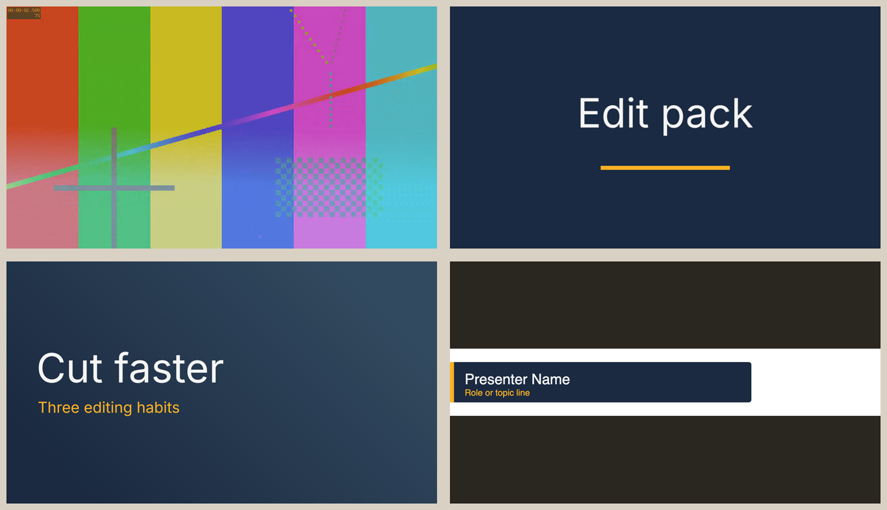

# The edit pack: cut, mix, composite and grade from Claude Code or Codex

Motion graphics are half of most videos. The other half is editing: cutting a screen recording or footage on a timeline, mixing a voice-over over music so the music dips when you speak, compositing an animated title, making the thumbnail. The optional edit pack lets the agent do that work too, headless, and hands the result to the same checks as everything else.

It installs the command-line tools of six free, open-source desktop editors, the ArtCraft apps by [storytold](https://github.com/storytold), each licensed MIT or Apache-2.0 at your option. brief2mp4 does not redistribute them: the installer downloads each one from its own GitHub release and verifies it first. The full reference, written for the agent, is [edit/README-EDIT.md](../plugin/skills/brief2mp4/edit/README-EDIT.md).

<p align="center">
  
</p>

## The six apps

| Component | App | Pinned version | Like | The agent uses it for | Tested recipe |
|---|---|---|---|---|---|
| `film` | [FilmCraft](https://github.com/storytold/filmcraft) | 0.20.1 | Premiere | clips on a timeline, transitions, titles, export | `film_timeline.sh` |
| `sound` | [SoundCraft](https://github.com/storytold/soundcraft) | 0.20.1 | a DAW | voice and music on separate tracks, ducking with automation, bounce | `sound_mix.sh` |
| `effect` | [EffectCraft](https://github.com/storytold/effectcraft) | 0.24.1 | After Effects | layered, keyframed compositing and titles | `effect_title.sh` |
| `photo` | [PhotoCraft](https://github.com/storytold/photocraft) | 0.23.1 | Photoshop | thumbnails, title cards | `photo_thumbnail.sh` |
| `vector` | [VectorCraft](https://github.com/storytold/vectorcraft) | 0.24.1 | Illustrator | logos and lower thirds as SVG | `vector_lower_third.sh` |
| `light` | [LightCraft](https://github.com/storytold/lightcraft) | 0.21.1 | Lightroom | grading stills with presets, raw development | `light_grade.sh` |

The apps are alpha software and change quickly, so the versions are pinned, the recipes are tested against those versions, and the skill tells the agent to list each app's real commands (`<app>-cli commands`) before using one a recipe does not already use.

## When to use it

HyperFrames, Three.js and Blender still make the graphics, type, charts and 3D, and ffmpeg still finishes the file. Reach for the pack when the job is editing rather than generating:

- a tutorial, vlog or skit built from several recorded clips, with trims, a dissolve and a title on top (FilmCraft);
- a voice, a music bed and sound effects on separate tracks, with the music lowered under speech (SoundCraft);
- layered, keyframed titles and effects where an HTML page would be a re-implementation (EffectCraft);
- a thumbnail or title card (PhotoCraft), a lower third or logo as SVG (VectorCraft), a graded still (LightCraft).

If one HyperFrames page already does the job, use HyperFrames.

## Install

From the repository root, with the rest of brief2mp4:

```bash
bash install.sh --with-edit                                          # film + sound
bash install.sh --with-edit=film,sound,effect,photo,vector,light     # all six
```

```powershell
powershell -ExecutionPolicy Bypass -File .\install.ps1 -WithEdit film,sound
```

Or the pack's own installer, from the skill folder (`plugin/skills/brief2mp4` in a clone), which also has a dry run:

```bash
bash edit/install_edit.sh --components all --dry-run      # print every download and its size, change nothing
bash edit/install_edit.sh --components film,sound,effect,photo,vector,light
bash scripts/detect_edit.sh                               # edit: ready (film,sound,...) or edit: not installed
```

It needs `curl` and Node.js (already required by brief2mp4), plus `unzip` or `bsdtar` on macOS. Nothing uses sudo or admin rights, and nothing changes your system PATH. Everything goes into `~/.brief2mp4/edit` (Windows `%USERPROFILE%\.brief2mp4\edit`; set `B2M_EDIT_HOME` for another folder), and the installed pack never reads from the clone or the plugin cache.

| Download | macOS | Linux x86_64 | Windows x64 |
|---|---|---|---|
| film + sound | 104.0 MB | 127.9 MB | 127.2 MB |
| all six | 536.3 MB | 606.2 MB | 617.4 MB |

On macOS the six apps take about 1.15 GB on disk once installed. The per-app sizes are in [edit/README-EDIT.md](../plugin/skills/brief2mp4/edit/README-EDIT.md#where-it-goes-and-how-big).

## How every download is verified

Before anything is unpacked, each download is checked three ways:

1. its SHA-256 must equal the line in the release's own `SHA256SUMS.txt`;
2. the same hash must equal the one pinned in this repository's `versions.json`, so a release that is changed after the fact does not install;
3. when `gpg` is installed, `SHA256SUMS.txt.asc` must verify against the release signing key, whose fingerprint is also pinned in `versions.json`.

Without gpg the installer prints `signature: SKIPPED` and both hash checks still run. A mismatch installs nothing and deletes nothing you had.

## The tested recipes

Each recipe is a bash script (Git Bash on Windows) that does one real job headless with the pinned CLI, makes its own sample inputs when you give none, and prints `ok: <file> ...`. Run any of them with `--help`.

| Recipe | What it makes |
|---|---|
| `film_timeline.sh` | two clips on a timeline, a 1 s cross dissolve at the cut, a title, an H.264 MP4 with AAC |
| `sound_mix.sh` | a voice over a music bed, the bed ducked under the voice with volume automation, a 48 kHz stereo 24-bit WAV |
| `effect_title.sh` | a 3 s animated title: tracking-in text, fade and rise keyframes, a growing accent bar |
| `photo_thumbnail.sh` | a 1280x720 PNG thumbnail with a gradient, a title and a subtitle |
| `vector_lower_third.sh` | a lower-third SVG with a panel, an accent bar, a name and a role |
| `light_grade.sh` | one still graded with a built-in preset (Warm Glow by default); the original is untouched |

```bash
R=~/.brief2mp4/edit/recipes
bash $R/film_timeline.sh --out cut.mp4
bash $R/film_timeline.sh --clip-a a.mp4 --clip-b b.mp4 --title "Step one" --out cut.mp4
```

The first line, with the generated test clips, ran in under two seconds on an Apple M-series laptop and printed `ok: cut.mp4 (5.013000 s, 1280x720) cut with filmcraft`.

## It still ends in the same checks

An edit export is a rough render like any other. A FilmCraft cut or an EffectCraft render goes into HyperFrames as a video layer or straight to the finisher; a SoundCraft bounce goes to `finish.sh --audio`; thumbnails and lower thirds are stills or overlays.

```bash
S=/path/to/brief2mp4/plugin/skills/brief2mp4/scripts
bash $S/finish.sh --in cut.mp4 --out final.mp4 --seconds 5 --size 1280x720 --keep-audio
bash $S/check_delivery.sh final.mp4 --seconds 5 --size 1280x720
```

[Example 07](../examples/07-edit-tutorial/BRIEF.md) is a brief that needs the pack: two clips cut together with a title and a ducked voice-over mix, with a [sample report](../examples/07-edit-tutorial/SAMPLE-REPORT.md).

## Going beyond the recipes

Ask the pinned CLI before using a command: `filmcraft-cli commands`, `soundcraft-cli commands`, `effectcraft-cli commands --filter TEXT`, `photocraft-cli commands --filter TEXT`, `vectorcraft-cli commands`, `lightcraft-cli commands`. Each app also has an MCP server (`<app>-cli mcp`) for interactive work; use it only when the CLI cannot do the job. SoundCraft, EffectCraft, PhotoCraft and VectorCraft can confine an MCP session to chosen folders with `--automation-read-root` and `--automation-write-root`; FilmCraft 0.20.1 and LightCraft 0.21.1 cannot, so drive those two through the CLI. The details, including how each app keeps state between calls, are in [edit/README-EDIT.md](../plugin/skills/brief2mp4/edit/README-EDIT.md).

## Uninstall

```bash
bash install.sh --uninstall --uninstall-edit                # brief2mp4 and the edit pack (from the repository root)
bash edit/install_edit.sh --uninstall                       # the edit pack only (from the skill folder)
bash edit/install_edit.sh --uninstall --components photo    # one app
```

Only the paths the installer recorded in its manifest are removed. Anything else you put in that folder stays.

## What was tested

CI on macOS, Ubuntu and Windows (including Windows PowerShell 5.1) installs FilmCraft and SoundCraft with the native installer for each system, checks every download's hashes and signature, runs the cut and mix recipes, and passes the result through `finish.sh` and `check_delivery.sh`. The EffectCraft, PhotoCraft, VectorCraft and LightCraft recipes are tested on macOS. The desktop apps themselves, and calling the apps' MCP servers from a live Claude Code or Codex session, are not tested.
