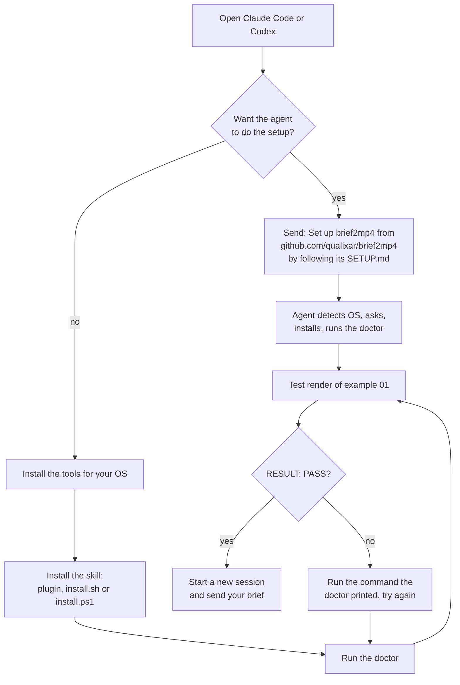

# Getting started

From nothing to your first checked video. About ten minutes on a fresh machine, two if Node and ffmpeg are already installed.



## 1. Install the tools

You need Node.js 22 or newer and ffmpeg for every video. Windows also needs Git for Windows, because the skill's scripts are bash and Git Bash runs them. Blender and Python are optional.

### macOS

```bash
brew install node ffmpeg
brew install --cask blender        # optional: photoreal shots
brew install python@3.12           # optional: the 3D pack
```

No Homebrew yet? Install it from [brew.sh](https://brew.sh).

### Windows (PowerShell)

```powershell
winget install -e --id OpenJS.NodeJS.LTS
winget install -e --id Gyan.FFmpeg
winget install -e --id Git.Git
winget install -e --id BlenderFoundation.Blender   # optional
winget install -e --id Python.Python.3.12         # optional: the 3D pack
```

Close the terminal and open a new one so the PATH updates. `install.ps1 -InstallTools` runs the first three for you.

### Ubuntu and Debian

```bash
sudo apt install -y ffmpeg git python3 python3-venv
curl -fsSL https://deb.nodesource.com/setup_22.x | sudo -E bash - && sudo apt install -y nodejs
```

Blender from [blender.org](https://www.blender.org/download): the apt package is often several versions old.

## 2. Install the skill

Pick one way per app. Installing both ways gives you two copies of the same skill.

| Way | Command |
|---|---|
| Claude Code plugin | `/plugin marketplace add qualixar/brief2mp4`, then `/plugin install brief2mp4@brief2mp4` |
| Codex plugin | `codex plugin marketplace add qualixar/brief2mp4`, then `codex plugin add brief2mp4@brief2mp4` |
| Script, macOS or Linux | `git clone https://github.com/qualixar/brief2mp4.git && bash brief2mp4/install.sh` |
| Script, Windows | clone the repo, then `powershell -ExecutionPolicy Bypass -File .\brief2mp4\install.ps1` |

Add `--with-3d` (or `-With3D core`) for the 3D pack; see the [3D walkthrough](3d-walkthrough.md). Add `--with-edit` (or `-WithEdit film,sound`) for the edit pack, the ArtCraft timeline editor and audio mixer, when your videos use real footage or a voice-over; see [edit/README-EDIT.md](../plugin/skills/brief2mp4/edit/README-EDIT.md).

## 3. Check the machine

```bash
bash brief2mp4/plugin/skills/brief2mp4/scripts/doctor.sh
```

```
brief2mp4 doctor (macos)
  ok       node      v22.22.3
  ok       ffmpeg    ffmpeg version 9.0.2
  ok       ffprobe   ffprobe version 9.0.2
  ok       git       git version 2.54.0
  ok       blender   Blender 5.2.1 LTS  [optional]
  ok       python    python3.13 3.13  [optional]
  missing  3d-pack   optional. Install: bash install.sh --with-3d  [optional]
RESULT: ready
```

Every required line must say `ok`. A `missing` line prints the command that fixes it. Add `--json` for a machine-readable version.

## 4. Make your first video

Start a new session in an empty folder (apps load skills when a session starts) and send:

> Use the brief2mp4 skill to make the video in this brief: *(paste examples/01-kinetic-type/BRIEF.md)*

You get `final.mp4` and `REPORT.md`. Then send:

> Check it against the brief.

The agent re-reads your brief line by line, shows the evidence for each line, fixes any miss and renders again.

## 5. Write your own brief

The checklist that makes briefs work: length and size, palette as hex codes and a font, every on-screen word exactly, what happens when (with times), sound, and a "done when" list of checkable lines. The README has a template, and the [free guide](https://qualixar.com/learn/guides/brief2mp4-guide) covers it in depth.

## When something goes wrong

| Symptom | Fix |
|---|---|
| `ffmpeg: command not found` right after a winget install | Open a new terminal. If it persists, add the `bin` folder under `%LOCALAPPDATA%\Microsoft\WinGet\Packages\Gyan.FFmpeg*` to your user PATH |
| The agent says it cannot run `.sh` scripts on Windows | Install Git for Windows; Claude Code then uses Git Bash. From PowerShell run scripts as `& "C:\Program Files\Git\bin\bash.exe" script.sh` |
| The skill is not found after installing | Start a new session. Apps load skills at session start |
| `node` is older than 22 | Upgrade Node (`brew upgrade node`, or the winget/nodesource line above) |
| Blender is installed but the doctor says missing (Windows, custom folder) | Put `blender.exe`'s folder on the PATH, or set `B2M3D_BLENDER` to its full path |
| The render is slow | Close other heavy apps and render one video at a time; drafts use `--quality draft` |
