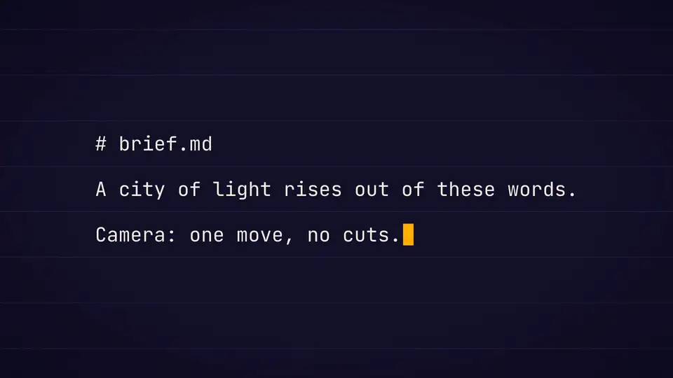

# Example 08: one brief, five worlds

<p align="center">
  
</p>

This is the video at the top of the brief2mp4 README, and this page shows how to make it yourself and how to check it. It is 25 seconds and one camera move with no cuts. The words of a brief peel off the page, become a 3D city of light, the camera flies through a window into a flat 2D chart world, rides a growing bar up into a galaxy of 27,000 particles, and the galaxy shrinks into the full stop of the title. The last frame matches the first, so it loops.

It uses most of what the skill can do in one piece: 2D type and charts in HyperFrames with GSAP, 3D and particles in Three.js, a soundtrack, and finishing with ffmpeg. [Watch the MP4 with sound](../../assets/example08-five-worlds.mp4).

## What is in this folder

| File | What it is |
|---|---|
| [BRIEF.md](BRIEF.md) | The brief, exactly as it was pasted. Copy this. |
| [SAMPLE-REPORT.md](SAMPLE-REPORT.md) | The report the skill wrote for the video above: every line of the brief marked met or not met, with the measurement or still behind it, render settings and open points. |
| [check.sh](check.sh) | Runs every check from the brief's "Done when" list on your own `final.mp4`. |
| [hue_scan.py](hue_scan.py) | Used by `check.sh` to show that no part of the frame turns teal or mint. |

## Make it

1. Install brief2mp4 (see [Quick start](../../README.md#quick-start)) and run the doctor once. You need Node.js 22+ and ffmpeg. The 3D pack and Blender are not needed: all of the 3D here is Three.js.
2. Make an empty folder for the video and open Claude Code or Codex in it.
3. Send this, then paste the whole of [BRIEF.md](BRIEF.md) under it:

   > Use the brief2mp4 skill to make the video in this brief:

4. Let it work. It writes `SPEC.md` first, builds the page, the city, the chart world and the galaxy in one HyperFrames composition, snapshots stills, renders, finishes with ffmpeg and writes `REPORT.md`. Expect a longer run than the 12-second examples, because there are five worlds to build and check.
5. When it says it is done, send:

   > Check it against the brief.

   It goes back to the brief line by line, shows the evidence for each line, fixes what falls short and renders again.

Your video will not be pixel-identical to ours. The brief fixes the words, the timing, the palette and the checks, and leaves the details of each world to the agent. The checks below are what every version has to pass.

## Check it

Run the checks in your video's folder:

```bash
bash /path/to/brief2mp4/examples/08-brief-becomes-world/check.sh final.mp4
```

It finds the skill's scripts on its own (pass the scripts folder as a second argument if it cannot), writes stills to `./checks` and prints one block per check. These are the numbers from the video above:

| Check | Command inside `check.sh` | Pass when | Our video |
|---|---|---|---|
| Size, frame rate, length, codecs, loudness | `check_delivery.sh final.mp4 --seconds 25 --size 1920x1080 --fps 30 --lufs -16` | `RESULT: PASS` | PASS, -15.3 LUFS |
| No cuts in the camera move | ffmpeg `scdet=threshold=10` | 0 scene cuts | 0 |
| It loops | SSIM of the first frame vs the last | 0.90 or more | 0.973 |
| The title is big and holds still | `bounds.py` on the stills at 20.5, 22.0 and 23.5 s | box 150 px or taller, same box each time | 290 px, identical |
| Type stays off the edges | `bounds.py --margin 64,64` at 22.0 s | `"inside": true` | true |
| No teal or mint | `hue_scan.py` over every still | a fraction of a percent, no region | 0.0009 % at most |

Then open the stills in `./checks`, because some lines of a brief can only be checked by looking. At 1.8 s at least one word of the second line should be off the page. At 6.0 s you should see the city, at 11.5 s the chart world, at 17.0 s the galaxy and at 22.0 s the title, each in the colours of the brief's palette table. The five chips in the bottom-left corner, one per world, should read exactly as the brief writes them.

## Make your own version

The brief is built to be edited. Keep its shape and change what you like:

- **Change the worlds.** Swap the city for a forest, or the galaxy for an ocean. Keep one "what happens when" step per world, with a time range and the colours it uses.
- **Keep the handoffs physical.** The no-cuts check passes because every world is entered by moving the camera (into a window, up a bar, into a point of light), never by cross-fading. Write each transition as a camera move.
- **Keep the palette table.** One row per world, with exact hex codes, is what makes the colour bold and still under control. A "never use" line (here: teal and mint) gives the check something to measure.
- **Keep the Done-when list measurable.** Every line should name a frame or a number: a still at a time, a cut count, an SSIM, a size in pixels, a loudness. Those numbers are what make "Check it against the brief." useful.
